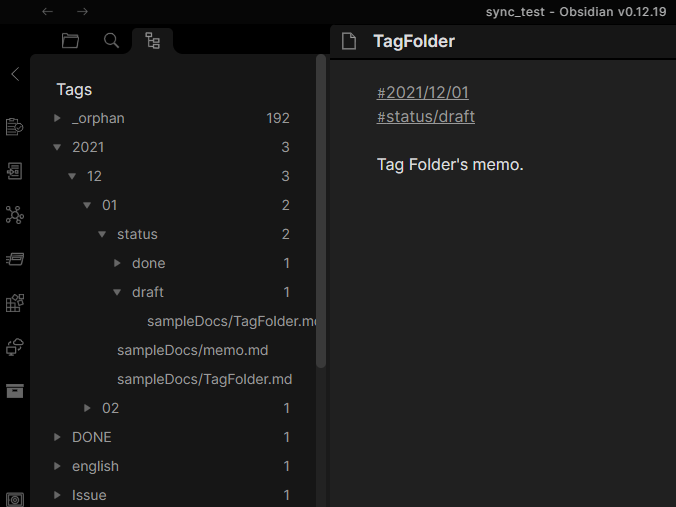
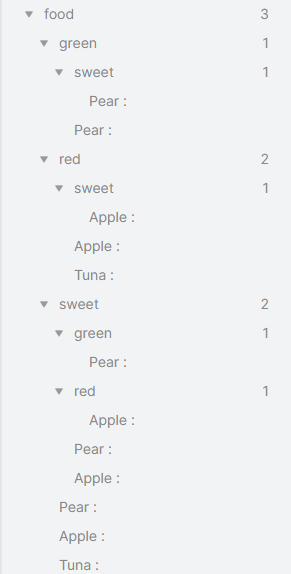
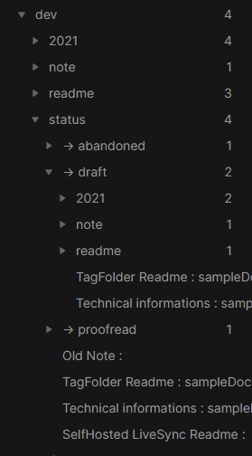
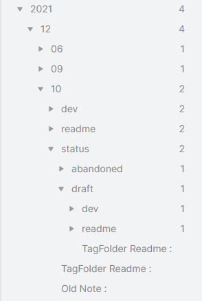

# TagFolder

Browse your Obsidian notes through their tags as if they were folders. Notes with several tags can appear in several branches, and nested tags keep their hierarchy.



- [Get started](#get-started)
- [Browse by tags](#browse-by-tags)
- [Choose what appears](#choose-what-appears)
- [Find notes](#find-notes)
- [Create notes](#create-notes)
- [Settings](#settings)
- [Development](#development)

## Get started

Requires Obsidian 1.7.2 or later.

1. Install and enable TagFolder from Obsidian's community plugins.
2. Open the command palette with `Ctrl+P` (`Cmd+P` on macOS) and run `Show Tag Folder`.
3. Expand a tag folder and select a note to open it.

TagFolder opens in the left sidebar. To open it automatically when Obsidian starts, enable [Always Open](#always-open). Notes normally appear within the tag tree; [List files in a separated pane](#list-files-in-a-separated-pane) moves the file list to a separate pane.

## Browse by tags

Tags used together can form additional branches to narrow the matching notes.

### Choose a tree style

Open **Settings → TagFolder → Tags → Suggested tag tree styles** to preview a style, then choose `Apply`:

- `Simple list` shows notes directly beneath each tag and displays their other tags as labels.
- `Drill-down` uses other tags as additional folders and shows notes at the deepest matching level.
- `Full tree` also shows notes at intermediate levels.

The related settings remain individually editable after applying a style.

### Simple case

For example, these notes can appear under several matching tag folders:
```
Apple : #food #red #sweet
Pear  : #food #green #sweet
Tuna  : #food #red
```


The same note can appear in each matching branch.

### Nested tags

Nested tags retain their parent hierarchy. For example, `#status/draft` appears beneath `#status`:

```
TagFolder Readme: #dev #readme #2021/12/10 #status/draft
Technical information: #dev #note #2021/12/09 #status/draft
SelfHosted LiveSync Readme : #dev #readme #2021/12/06 #status/proofread
Old Note: #dev #readme #2021/12/10 #status/abandoned
```
#### Tag hierarchy of status



#### Tag hierarchy of date



### Sort notes and tags

Use the `Change sort order` button in the toolbar. In the tag tree, choose `Items` to sort notes or `Tags` to sort tag folders. In a separate file list pane, the note-order options appear directly in the menu.

Choose `Tag grouping Ascending` or `Tag grouping Descending` to keep notes together by their written tag sequence. For example, `#project #client` and `#project #client #report` share the same leading tags and stay together. See [Files](#files) for the full ordering rules.

## Choose what appears

Open **Settings → TagFolder → Filters** to control which notes and tags appear. These settings change TagFolder's views while keeping files in their existing Vault locations.

| Goal | Setting | Example value |
| --- | --- | --- |
| Show only notes from selected folders | `Target Folders` | `Projects/,Reference/` |
| Exclude notes in a folder | `Ignore Folders` | `Templates/` |
| Exclude an entire note when it has a matching tag | `Ignore note Tag` | `#private,#private/*` |
| Hide matching tags while keeping notes available under other tags | `Ignore Tag` | `#status,#status/*` |
| Keep archived notes under their archive tags in the tree | `Archive tags` | `#archive,#archive/*` |

For a note tagged `#project #private/client`, setting `Ignore note Tag` to `#private/*` removes the note from both the tag tree and note lookup. The same value in `Ignore Tag` hides `#private/client` while leaving the note available under `#project`.

Tag filters match exact tags by default: `#private` matches that tag alone, and `#private/*` matches its descendants. Use `#private,#private/*` to match both. A leading `#` is optional, and matching ignores letter case. See [Filters](#filters) for more pattern examples.

Ignored-note and ignored-tag patterns also apply to `Open note by tags` and `Open note with similar tags`. `Archive tags` changes the note's location in the tree; archived notes remain available to those lookup commands. For a query without changing saved settings, use [Find notes](#find-notes).

## Find notes

### Search the tag tree

Use the search field to combine tags, exclude tags with `-`, and separate alternatives with `|`. For the notes above:

```
sweet -red | food -sweet
```

This shows `Pear` (sweet but not red) and `Tuna` (food but not sweet).

With [Search tags inside TagFolder when clicking tags](#search-tags-inside-tagfolder-when-clicking-tags) enabled, clicking a tag in a note updates the search field to show the current conditions. Clear the field to remove the search query.

### Open notes by tags

Run `Open note by tags` from the command palette to find and open a note by incrementally adding tag conditions. Positive tags use OR matching and results with more matching tags appear first. Prefix a tag with `-` to exclude matching notes completely. A separate note input fuzzily filters titles and Vault-relative paths.

Run `Open note with similar tags` while a Markdown note is active to start with that note's tags selected. The active note itself is omitted from the results.

Selecting a parent tag such as `#project` also finds notes with nested tags such as `#project/client`.

The dialogue is keyboard-operable:

- Type a tag, then press `Space` or `Enter` to accept a completion.
- Press `Backspace` in an empty tag input to remove the last tag, or press `ArrowLeft` to select a tag chip and remove it with `Backspace` or `Delete`.
- Press `Tab` or `Shift+Tab` to switch between the tag and note inputs.
- Press `ArrowUp` or `ArrowDown` to select a completion or note.
- Press `Enter` to open the selected note, or `Ctrl+Enter`/`Cmd+Enter` to open it in a new tab.

## Create notes

Use the `New note` button in TagFolder to create a note with the current tags. To reuse an open note's tags, run `Create a new note with the same tags` from the command palette.

The following options are under **Settings → TagFolder → Tags**.

### Store tags in frontmatter for new notes

This setting changes how tags are stored in new notes created by TagFolder. When disabled, tags are stored as #hashtags at the top of new notes. When enabled, tags are stored in the frontmatter and displayed in the note's Properties.

### Template for new notes

When this setting is set to a valid markdown template path, TagFolder uses that template immediately when creating a new note from the tag tree. The `.md` extension is optional. If a non-empty path is invalid, TagFolder opens a template picker. If the setting is empty, TagFolder creates the note without a template and uses the configured Properties or hashtag behaviour.

If templates change while the settings tab is open, reopen it to refresh the suggestions. The template picker refreshes its list each time it opens.

Templates can include these placeholders, which are replaced with the tags from the clicked location:

| Placeholder                    | Replacement                                  |
| ------------------------------ | -------------------------------------------- |
| `{{expandedTags}}` or `{{tags}}` | Tags as hashtags, e.g. `#tag1 #tag2`           |
| `{{tagList}}`                  | Tags as comma-separated text, e.g. `tag1, tag2` |
| `{{tagPath}}`                  | Tags as a slash-separated path, e.g. `tag1/tag2` |
| `{{tagName}}`                  | The last tag in the clicked context           |
| `{{tagsJson}}`                 | Tags as a JSON array                          |
| `{{tagsYaml}}`                 | Tags as YAML list lines                       |

## Settings

Open **Settings → TagFolder** to customise the tree and file list. The sections below follow the setting groups; [language options](#language) are at the end of this reference.

### Behavior

#### Always Open

Place TagFolder on the left pane and activate it at every Obsidian launch.

#### Use pinning

Pin tags using the configured pin information file. Pinned tags are sorted by `key` in its frontmatter; the default file is `taginfo.md`.

#### Pin information file

Choose the file which stores pin information. This can also be configured from the context menu.

| Item     | Meaning of the value                                                    |
| -------- | ----------------------------------------------------------------------- |
| key      | Pins the tag and determines its order.                                   |
| mark     | The label shown instead of `📌`.                                         |
| alt      | Displays this label without merging tags. No `#` is required.             |
| redirect | Redirects and merges the tag into the configured tag. No `#` is required. |

#### Disable narrowing down

Show related tags alongside note titles instead of using them to create additional folders.

### Files

#### Display method

Choose whether entries show their name, path, or both.

#### Order method

You can order items by:

- Displaying name
- Filename
- Tag grouping
- Modified time
- Fullpath of the file

`Tag grouping` treats tags in their written order as a sequence of branches. In ascending order, `#project #client` comes before `#project #client #report`, keeping that branch together before moving to the next branch. Notes with the same tags in a different order belong to different branches. Untagged notes come first, and virtual tags are excluded from grouping. Descending order reverses this sequence.

Names and tags are compared using the Obsidian interface language, with natural numeric ordering.

#### Use title

Show the frontmatter title or first level-one heading in place of `NAME`.

#### Frontmatter path

Set the dotted path used to retrieve the title from frontmatter.

### Tags

#### Suggested tag tree styles

Preview and apply a style as described in [Choose a tree style](#choose-a-tree-style). Each style updates the related tag-tree settings together.

#### Order method

You can order tags by:

- Filename
- Count of items

#### Use virtual tags

Add virtual tags based on when a note was last edited:

| Icon | Edited ...            |
| ---- | --------------------- |
| 🕐    | Within an hour        |
| 📖    | Within 6 hours        |
| 📗    | Within 3 days         |
| 📚    | Within 7 days         |
| 🗄    | Older than 7 days ago |

#### Display folder as tag

Show a note's folder as a tag.

### Actions

#### Search tags inside TagFolder when clicking tags

Search within TagFolder when clicking a tag instead of opening the default search pane. Use the Control and Shift modifiers to remove a tag from the search condition or add an exclusion.

#### List files in a separated pane

Show matching files in a separate pane. When disabled, files appear directly in the tag tree.

### Arrangements

#### Hide Items

Choose where notes appear in the tag tree.

- Hide nothing
- Only intermediates of nested tags
- All intermediates

<details>
<summary>Compare the three tree layouts</summary>

For these notes:
```
2021-11-01 : #daily/2021/11 #status/summarized
2021-11-02 : #daily/2021/11 #status/summarized
2021-11-03 : #daily/2021/11 #status/jot
2021-12-01 : #daily/2021/12 #status/jot
```

The options produce the following trees:

- Hide nothing

```
daily
	→ 2021
		→ 11
			status
				→ jot
					2021-11-03
				→ summarized
					2021-11-01
					2021-11-02
				2021-11-01
				2021-11-02
				2021-11-03
			2021-11-01
			2021-11-02
			2021-11-03
		2021-11-01
		2021-11-02
		2021-11-03
		2021-12-01
		→ 12
			:
	2021-11-01
	2021-11-02
	2021-11-03
	2021-12-01
```

- Only intermediates of nested tags

Show notes only at the end of, or a break in, a nested tag path.
```
daily
	→ 2021
		→ 11
			status
				→ jot
					2021-11-03
				→ summarized
					2021-11-01
					2021-11-02
			2021-11-01
			2021-11-02
			2021-11-03
		→ 12
			:
```
- All intermediates

Show notes only at the deepest levels.
```
daily
	→ 2021
		→ 11
			status
				→ jot
					2021-11-03
				→ summarized
					2021-11-01
					2021-11-02
		→ 12
			:
```

</details>

#### Merge redundant combinations

When this feature is enabled, a/b and b/a are merged into a/b if there are no intermediates.

#### Do not simplify empty folders

Keep empty folders, even if they can be simplified.

#### Do not treat nested tags as dedicated levels

If you enable this option, every nested tag is split into normal tags.

`#dev/TagFolder` will be treated like `#dev` and `#TagFolder`.

#### Reduce duplicated parents in nested tags

For a note such as `example note` with nested tags sharing a parent, such as `#topic/calculus` and `#topic/electromagnetics`:

- Disabled

```
topic
	 - > calculus
		 topic
			   - > electromagnetics
				   example note
		 example note 
```
- Enabled

```
topic
	 - > calculus
		  - > electromagnetics
			  example note
		 example note 
```

### Filters

For examples of which setting to use, see [Choose what appears](#choose-what-appears).

Folder settings accept comma-separated Vault-relative paths. Use a trailing slash for a folder's contents, such as `Templates/` in `Ignore Folders`. Wildcards apply to the tag settings below.

Tag filter settings accept comma-separated tag names. A leading `#` is optional, so `tag1` and `#tag1` are treated the same.

By default, entries match exact tags only. Use `*` for glob matching:

```
tag1
#tag1/*
project/*/done
```

- `tag1` matches only `#tag1`.
- `#tag1/*` matches nested tags such as `#tag1/tag2` and `#tag1/tag3`.
- `tag1,tag1/*` matches both the parent tag and its descendants.
- `project/*/done` matches nested tags with any single or multi-level text between `project/` and `/done`.

Note lookup and similar-note lookup use the same ignored-note and ignored-tag patterns as the tag tree.

#### Target Folders

Limit TagFolder to files in these folders.

#### Ignore Folders

Exclude notes in these folders.

#### Ignore note Tag

Exclude notes with matching tags.
Glob entries can ignore a whole nested tag group, for example `#tag1/*`.

#### Ignore Tag

Hide matching tags while keeping their notes available under other tags.
Glob entries can hide matching nested tags while leaving non-matching tags visible.

#### Archive tags

If configured, notes with matching tags are shown under those tags instead of unrelated top-level tag folders.
Glob entries can archive a whole nested tag group, for example `#archive/*`.

### Language

The interface is available in English and Simplified Chinese.

-   Go to **Settings → TagFolder → Language** and choose `Auto (follow Obsidian)`, `English`, or `简体中文`.
-   `Auto` follows the Obsidian interface language and falls back to English when the language cannot be matched.
-   The bundled Chinese translation uses Simplified Chinese. Traditional Chinese falls back to English in `Auto`; choose `简体中文` explicitly to use the Simplified Chinese interface.
-   Names and tags are sorted using the Obsidian interface language. Choosing a different TagFolder display language changes labels while preserving that sorting language.

## Development

Contributor setup, tests, and UI/Vault workflow architecture are documented in [the developer guide](docs/devs.md).
